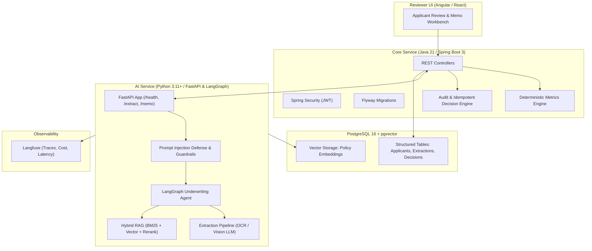

# System Architecture: AI Underwriting Copilot for MSME Lending

## Architectural Design Principles

1. **Deterministic Metrics vs Generative Synthesis**:
   - The LLM never computes arithmetic, interest, debt ratios, or financial aggregates.
   - Core-Service computes verified metrics (DSCR, AMB, Inflow/Outflow volatility, Cheque Bounce rates) in deterministic, test-driven Java code.
   - The AI Service cites these verified figures by metric ID.

2. **Confidence-Gated Review Pipeline**:
   - Every extracted field carries a confidence score [0.0, 1.0] and source provenance.
   - Low confidence fields (< 0.85 default threshold) are marked `NEEDS_REVIEW` and routed to the human reviewer queue.

3. **Citations as Invariants**:
   - Credit memos must explicitly ground every claim against a verified metric ID or an ingested policy clause ID.
   - Uncited claims trigger validation rejection in the agent graph.

4. **Multi-Model / Swappable Providers**:
   - LLMs and embeddings are accessed via unified abstractions swappable via `.env` (Gemini, OpenAI, Anthropic, Ollama).
